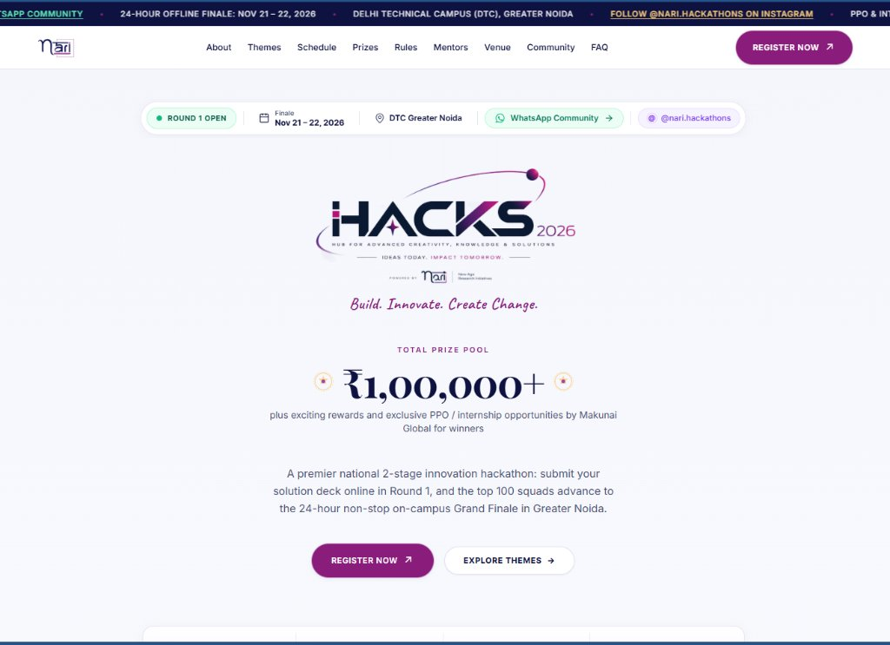
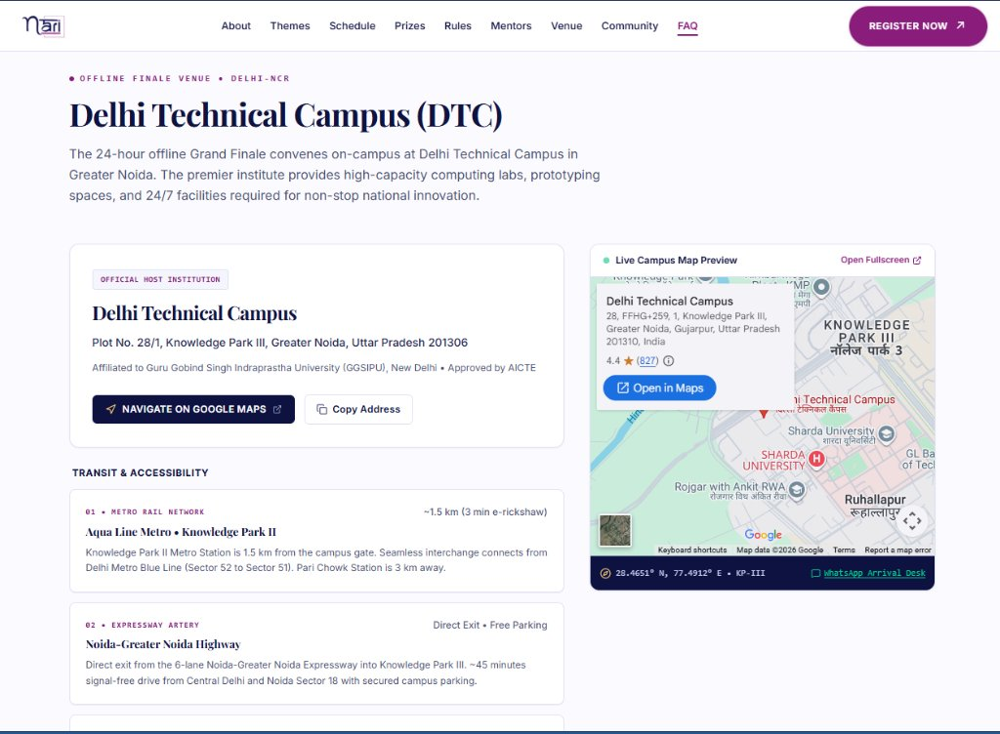
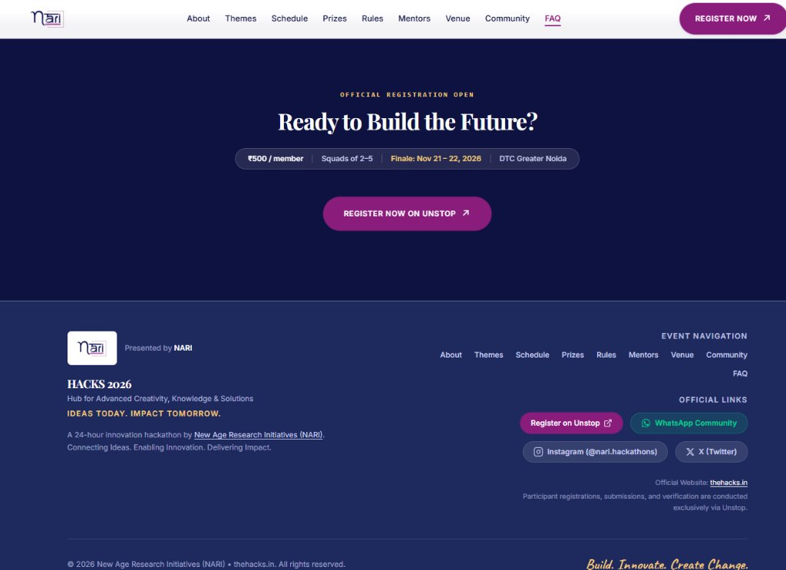

# HACKS 2026 — Official Website 🚀

<div align="center">



**Hub for Advanced Creativity, Knowledge & Solutions**  
*Ideas Today. Impact Tomorrow.* • *Build. Innovate. Create Change.*

[](https://thehacks.in/)
[](https://react.dev/)
[](https://vitejs.dev/)
[](https://tailwindcss.com/)
[](https://unstop.com/p/hacks-2026-hub-for-advanced-creativity-knowledge-solutions-nari-nexus-1759592)
[](LICENSE)

---

### 🌐 **Live Production Link:** [https://thehacks.in/](https://thehacks.in/)
*Presented by **New Age Research Initiatives (NARI)** in partnership with **Makunai Global***

</div>

---

## 👨‍💻 Sole Developer & Project Ownership

> **Solo Project Note:**  
> This complete website was independently conceptualized, architected, designed, and developed by **Prakhar** as a solo engineer for **New Age Research Initiatives (NARI)**. It serves as the official live public-facing portal for **HACKS 2026**, handling national event visibility, round guidelines, venue instructions, and registration flows through Unstop.

---

## 📸 Website Previews & Screenshots

### 1. Hero & Prize Pool Showcase
*Dynamic branding, official hackathon insignia, ₹1,00,000+ prize pool banner, and one-click registration integration.*


### 2. Grand Finale Venue & Interactive Transit Guide
*Detailed showcase of Delhi Technical Campus (DTC), Greater Noida with interactive Google Maps preview, nearest metro stations (Aqua Line), and road transit guidelines.*


### 3. Registration Call-to-Action & Official Channels
*High-conversion closing section with official NARI links, WhatsApp arrival desk, Instagram, and X channels.*


---

## ✨ Key Features & Architecture Highlights

- ⚡ **Cutting-Edge Tech Stack:** Engineered with the latest **React 19**, **Vite 8**, and **Tailwind CSS v4** engine for lightning-fast load times and instant HMR.
- 🎯 **Single Source of Truth Configuration (`hackathonConfig.js`):** All event parameters (dates, deadlines, prize pool, team size, venue coordinates, Unstop URLs, social handles) are centralized in one file. Zero hardcoded text throughout the UI.
- 🏆 **2-Stage National Hackathon Flow:**
  - **Round 1 (Online):** PPT idea submission and evaluation.
  - **Round 2 (Offline Grand Finale):** 24-hour non-stop prototyping sprint on-campus at Delhi Technical Campus (DTC), Greater Noida.
- 🗺️ **Venue & Accessibility Guide:** Real-time campus location preview, transit information (Knowledge Park II Metro Station, Pari Chowk, Noida-Greater Noida Expressway), and on-site facility specifications (hardware labs, Wi-Fi, 24/7 meals).
- 💼 **Exclusive Hiring Partner Integration:** Highlighted partnership with **Makunai Global**, offering direct Pre-Placement Offers (PPOs) and paid internships to winners.
- 📱 **100% Fully Responsive Design:** Fluid layouts optimized across mobile devices, tablets, laptops, and ultra-wide displays.
- ♿ **Accessible & High-Performance:** Semantic HTML, keyboard-navigable components, WCAG-compliant color contrast, and optimized bundle sizes.
- 🔒 **Privacy & Confidentiality by Design:** No backend secrets, sensitive credentials, or private keys are bundled or exposed. Client-side static architecture guarantees secure, tamper-proof distribution.

---

## 🛠️ Technology Stack

| Layer | Technology | Version | Purpose |
| :--- | :--- | :--- | :--- |
| **Framework** | [React](https://react.dev/) | `^19.2.8` | Component-driven UI architecture |
| **Build Tool** | [Vite](https://vitejs.dev/) | `^8.3.0` | Ultra-fast bundling & development server |
| **Styling** | [Tailwind CSS](https://tailwindcss.com/) | `^4.3.3` | Next-gen CSS utility engine (`@tailwindcss/vite`) |
| **Routing** | [React Router DOM](https://reactrouter.com/) | `^7.18.4` | Client-side routing & page navigation |
| **Motion** | [Framer Motion](https://www.framer.com/motion/) | `^13.4.0` | Micro-interactions and fluid layout transitions |
| **Icons** | [Lucide React](https://lucide.dev/) | `^1.47.0` | Clean, modern vector icons |
| **Linter** | [Oxlint](https://oxc.rs/) | `^1.81.0` | High-performance Rust-based JavaScript linter |

---

## 📂 Project Directory Structure

```text
nari/
├── public/                    # Static public assets (logos, favicon, web manifest)
│   ├── hacks-logo.png         # Official HACKS 2026 emblem
│   ├── nari-logo.png          # NARI organization logo
│   ├── makunai-logo.png       # Makunai Global talent partner logo
│   └── favicon.svg            # Browser favicon
├── screenshots/               # GitHub README visual showcase
│   ├── 01-hero-section.jpg
│   ├── 02-venue-section.jpg
│   └── 03-footer-section.jpg
├── src/
│   ├── App.jsx                # Application root with React Router
│   ├── index.css              # Global CSS & Tailwind CSS v4 design tokens
│   ├── config/
│   │   └── hackathonConfig.js # 🌟 Central Single Source of Truth
│   ├── components/            # Reusable UI modules
│   │   ├── Navbar.jsx         # Sticky navigation with mobile drawer
│   │   ├── Hero.jsx           # Hero banner with prize pool callouts
│   │   ├── Themes.jsx         # Problem statement tracks & domains
│   │   ├── Schedule.jsx       # 6-stage interactive timeline
│   │   ├── Venue.jsx          # Delhi Technical Campus venue details & map
│   │   ├── Prizes.jsx         # Rewards, rewards breakdown & Makunai hiring banner
│   │   ├── Rules.jsx          # Hackathon guidelines & squad constraints
│   │   ├── Mentors.jsx        # Industry mentor & judging panel
│   │   ├── FAQ.jsx            # Accordion FAQ for participants
│   │   └── Footer.jsx         # Footer with official links & copyright
│   └── pages/
│       ├── HomePage.jsx       # Main single-page landing view
│       └── MentorsPage.jsx    # Dedicated mentors directory
├── .gitignore                 # Strict rules to prevent leaking sensitive files
├── index.html                 # HTML entry with OpenGraph & SEO tags
├── package.json               # Dependencies and scripts
└── vite.config.js             # Vite configuration with Tailwind plugin
```

---

## 🚀 Getting Started Locally

### Prerequisites
- **Node.js**: `v18.0.0` or higher (Node 20+ recommended)
- **npm**: `v9.0.0` or higher

### 1. Clone the Repository
```bash
git clone https://github.com/YOUR_USERNAME/YOUR_REPOSITORY_NAME.git
cd YOUR_REPOSITORY_NAME
```

### 2. Install Dependencies
```bash
npm install
```

### 3. Run Development Server
```bash
npm run dev
```
Open [http://localhost:5173/](http://localhost:5173/) in your browser to view the application with live hot-reload.

### 4. Build for Production
```bash
npm run build
```
This compiles and minifies the code into the `dist/` directory, ready for immediate deployment on Vercel, Netlify, Cloudflare Pages, or traditional static hosting.

### 5. Code Quality Check
```bash
npm run lint
```

---

## ⚙️ Customization & Updating Event Data

All content is maintained centrally in:
👉 **[`src/config/hackathonConfig.js`](src/config/hackathonConfig.js)**

To update details for future editions or modify deadlines:
```javascript
export const config = {
  brand: {
    websiteUrl: "https://thehacks.in/",
    // ...
  },
  event: {
    dates: "Nov 21 – 22, 2026",
    venue: "Delhi Technical Campus (DTC)",
    venueAddress: "Plot No. 28/1, Knowledge Park III, Greater Noida, Uttar Pradesh 201306",
    // ...
  },
  registration: {
    unstopUrl: "https://unstop.com/p/hacks-2026-hub-for-advanced-creativity-knowledge-solutions-nari-nexus-1759592",
    feePerMember: 500,
    minTeamSize: 2,
    maxTeamSize: 5,
  },
  prizes: {
    totalPool: "₹1,00,000+",
    // ...
  }
};
```

---

## 🛡️ Security & Confidentiality

- **Zero Secrets Committed:** No `.env` secrets, API keys, passwords, or personal credentials exist in this repository.
- **Protected by `.gitignore`:** Build artifacts (`dist/`), local dependencies (`node_modules/`), archive backups (`*.zip`, `hacks-2026-final/`), and local environment files (`.env*`) are strictly ignored.
- **Static Hosting Architecture:** The application compiles to static assets, removing runtime server vulnerabilities.

---

## 📜 License & Acknowledgements

- **Organizer:** [New Age Research Initiatives (NARI)](https://narinexus.com/)
- **Official Domain:** [thehacks.in](https://thehacks.in/)
- **Talent Partner:** [Makunai Global](https://www.makunaiglobal.ai/)
- **Registration Partner:** [Unstop](https://unstop.com/)
- **Sole Architect & Developer:** Prakhar
- **License:** Released under the [MIT License](LICENSE).
